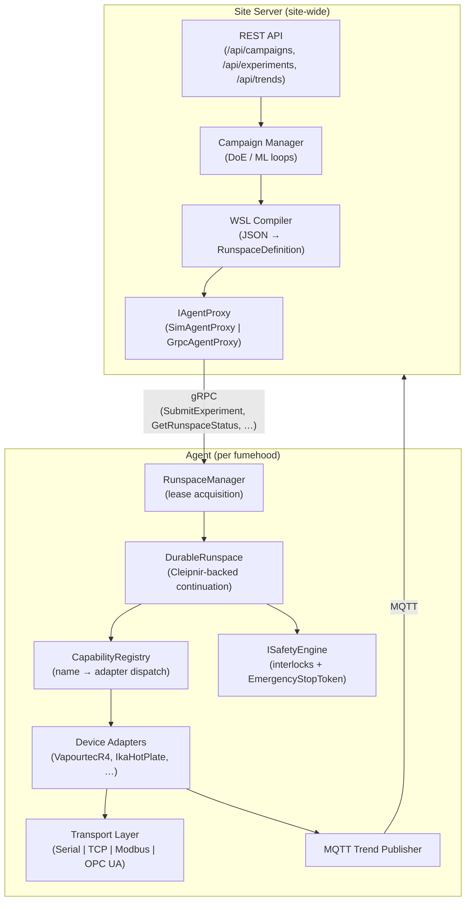
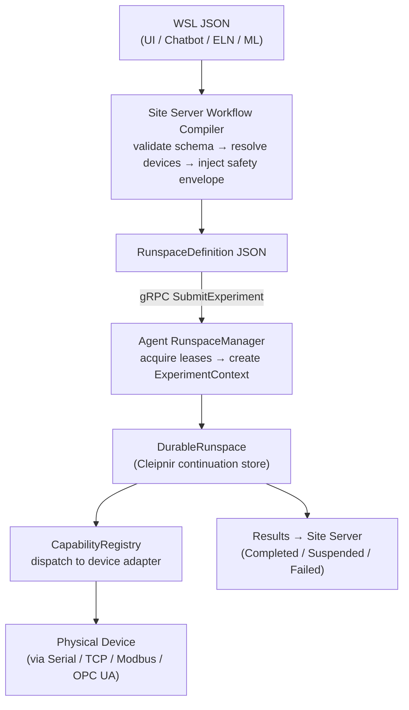

# Architecture Overview

## System Overview

Helix Orchestration is a **two-tier distributed platform** for coordinating scientific instruments in laboratory fumehoods. The **Agent** tier runs one process per fumehood — it owns local execution, device control, and safety enforcement. The **Site Server** tier operates site-wide: it compiles WSL workflows, manages campaigns, and provides the external REST and gRPC API.

Within each process the codebase follows **Clean Architecture**: the Core domain library has no outward dependencies; infrastructure projects depend inward. Subsystem boundaries are enforced by project structure and interfaces rather than runtime checks, making it straightforward to swap backends (simulation versus real hardware) at DI registration time.

## Two-Tier Architecture

## Key Concepts

| Concept | Layer | Description |
|---------|-------|-------------|
| `RunspaceDefinition` | Contracts | Compiled execution contract produced by the WSL compiler; JSON; consumed by Agent |
| `DurableRunspace` | Agent | One workflow instance container with its own `ExperimentContext`, device leases, and durable Cleipnir continuation state |
| `WorkflowContext` | Core | The single DI surface injected into a workflow — carries Capabilities, Trends, Safety, State, Experiment |
| `ICapabilityInvoker` / `CapabilityRegistry` | Core / Agent | Dispatches named capability verbs (e.g. `SetTemperature`) to the correct device adapter; workflows never see device protocols |
| `WSL` (Workflow Specification Language) | Contracts | JSON declarative authoring format; generated by UI, chatbot, ELN, or ML; compiled at Site Server to `RunspaceDefinition` |
| `IAgentProxy` | SiteServer | Seam between Site Server and Agent — `SimAgentProxy` for dev/test, `GrpcAgentProxy` for production |
| `ITrendProvider` | Core | Typed accessors for all trend kinds (scalar, spectral, diode array, image, video, derived) |
| `ISafetyEngine` | Core | Evaluates `InterlockRule` predicates; triggers `EmergencyStopToken` on critical violations |
| `ExperimentContext` | Core | Lifecycle state machine (Created → Running → Suspended → Completed/Failed); every measurement tagged with `ExperimentId` |
| `Campaign` | SiteServer | Site Server-owned multi-experiment orchestration unit (DoE grids, ML loops, sweeps); agents execute one experiment at a time |

## Experiment Submission Data Flow

## Projects and Responsibilities

| Project | Layer | Responsibility |
|---------|-------|----------------|
| `Helix.Orchestration.Core` | Domain | Workflow engine, capability invocation, trend model, safety, leasing, WSL contract, experiment lifecycle, state persistence abstractions |
| `Helix.Orchestration.Contracts` | Contracts | gRPC protobuf definitions (`adapter.proto`, `agent_control.proto`), generated client stubs |
| `Helix.Orchestration.Devices` | Device Abstraction | Transport interfaces, device model interfaces (`IDevice`, `IReactionPlatform`, `IHplc`, `ISetPointDevice`, `IVapourtec`), device result/measurement types |
| `Helix.Orchestration.Agent` | Application Host | Agent executable: runspace execution (`DurableRunspace`), device adapter discovery/registry, gRPC server, MQTT trend publishing, lease expiry worker, DI wiring |
| `Helix.Orchestration.SiteServer` | Application Host | Site Server executable: REST API, campaign manager, WSL compiler, simulation, `IAgentProxy` (sim/gRPC), MQTT bridge |
| `Helix.Orchestration.Infrastructure` | Infrastructure | PostgreSQL repositories for experiments/campaigns, EF Core migrations, MinIO object storage sink (`IObjectStorageSink`) |
| `Helix.Orchestration.Recorder` | Application Host | Standalone Worker Service: MQTT subscription, JSONL batch flushing to object storage, bounded-channel event capture |
| `Helix.Orchestration.Simulation` | Infrastructure/Test | Simulated devices (`SimReactor`, `SimPump`, `SimSpectrometer`), `SimAgentProxy` for hardware-free development |
