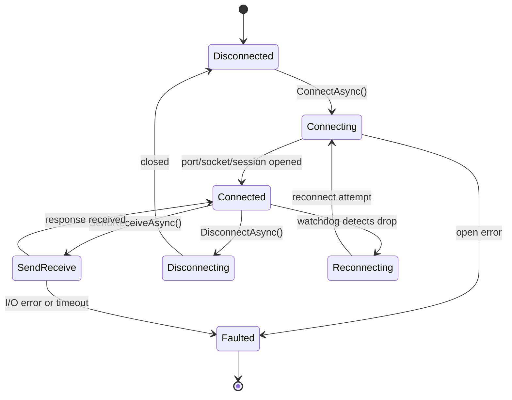

# Transport Guide

## Overview

All physical device communication in Helix goes through a transport abstraction.
Every transport implements IDeviceTransport (Helix.Orchestration.Devices.Abstractions):

- ConnectAsync / DisconnectAsync -- lifecycle management
- SendReceiveAsync(byte[], CancellationToken) -- request/reply exchange
- Status -- current TransportStatus (Disconnected, Connecting, Connected, Reconnecting, Faulted)
- StatusChanged -- `IObservable<TransportStatus>` for reactive monitoring
- DataReceived -- `IObservable<byte[]>` for unsolicited push data

Five concrete transport types are available:

| Transport | Class | Protocol |
|-----------|-------|----------|
| Serial | SerialDeviceTransport | RS-232 / RS-485 (ASCII or binary) |
| TCP | TcpDeviceTransport | Raw TCP socket |
| Modbus | ModbusDeviceTransport | Modbus RTU over serial |
| OPC UA | OpcDeviceTransport | OPC Unified Architecture |
| C DLL | CDllDeviceTransport | Native Windows vendor SDK via P/Invoke |

---

## Serial Transport

**Class:** SerialDeviceTransport
**Options:** SerialTransportOptions (PortName, BaudRate, CommandTerminator, read timeout)

The serial transport wraps System.IO.Ports.SerialPort with an internal async channel that
serialises concurrent SendReceiveAsync calls into a single-threaded job queue.
This prevents interleaved writes and reads that would corrupt multi-command conversations.

### ISerialTransport interface

```csharp
public interface ISerialTransport
{
    bool IsOpen { get; }
    void Open(string portName, int baudRate = 9600);
    void Close();
    string SendCommand(string command, int timeoutMs = 200);
    string SendCommand(byte[] command, int timeoutMs = 200);
    byte[] SendCommandFixedResponse(byte[] command, int expectedBytes, int timeoutMs = 200);
}
```

ISerialTransport is the lower-level interface used by older driver code. New adapters should
take SerialDeviceTransport (which implements IDeviceTransport) directly.

### Example usage (from VapourtecR4)

```csharp
private static byte[] Encode(string command) => Encoding.ASCII.GetBytes(command);
private static string Decode(byte[] response) => Encoding.ASCII.GetString(response).Trim();

var resp = Decode(await Transport.SendReceiveAsync(Encode("GV\r\n"), ct));
```

### DI registration

```csharp
services.AddHelixSerialAdapter<VapourtecR4>(options =>
{
    options.PortName = "COM3";
    options.BaudRate = 9600;
    options.CommandTerminator = "\r\n";
});
```
---

## TCP Transport

**Class:** TcpDeviceTransport
**Options:** TcpTransportOptions (Host, Port, SendTimeoutMs, ReceiveTimeoutMs, ConnectTimeoutMs, FramingMode)

The TCP transport connects with TcpClient and maintains a background read loop
that feeds a `Channel<byte[]>`. SendReceiveAsync writes the command bytes, then reads
from the channel according to the configured FramingMode.

### ITcpTransport interface

```csharp
public interface ITcpTransport
{
    int SendTimeout { get; set; }
    int ReceiveTimeout { get; set; }
    bool Connected { get; }
    ValueTask ConnectAsync(string address, int port, CancellationToken cancellationToken = default);
    NetworkStream GetStream();
    void Close();
}
```

### Framing modes

| Mode | TcpFramingMode value | When to use |
|------|----------------------|-------------|
| Delimiter | Delimiter | Protocol terminates responses with a known byte |
| Length prefix | LengthPrefix | Protocol prefixes each frame with a 4-byte length |
| Raw | Raw | Single-packet request/reply with no framing convention |

### DI registration

```csharp
services.AddHelixTcpAdapter<KnauerAzura>(options =>
{
    options.Host = "192.168.1.50";
    options.Port = 2101;
    options.ConnectTimeoutMs = 5000;
    options.ReceiveTimeoutMs = 10000;
    options.FramingMode = TcpFramingMode.Delimiter;
    options.DelimiterByte = 0x0A;
});
```

---

## OPC UA Transport

**Class:** OpcDeviceTransport
**Options:** OpcTransportOptions (EndpointUrl, ApplicationName, SessionTimeoutMs, AutoAcceptUntrustedCertificates)

The OPC UA transport uses the OPC Foundation .NET Standard library (OpcFoundationSession).
It supports four operations sent via SendReceiveAsync as JSON-encoded command objects:

| Operation | JSON operation field | Effect |
|-----------|----------------------|--------|
| Read | read | Read a node value by nodeId |
| Write | write | Write a value to a node |
| Call | call | Call a UA method (methodId + parameters) |
| Subscribe | subscribe | Subscribe to value changes via DataReceived |

### IOpcTransport interface

```csharp
public interface IOpcTransport
{
    bool IsConnected { get; }
    (bool Success, string Reason) Connect(string endpoint);
    void Disconnect();
    T Read<T>(string nodeId);
    void Write<T>(string nodeId, T value);
    IEnumerable<string> BrowseChildren(string parentNodeId);
}
```

### Browse and subscribe pattern

The Systag OPC UA driver discovers nodes dynamically at startup by browsing the server,
then subscribes to nodes of interest:

```csharp
var children = await session.BrowseChildrenAsync("ns=2;s=Reactor");

var subscription = await session.SubscribeNodeAsync(
    "ns=2;s=Reactor.Temperature",
    value => trendSubject.OnNext((double)value!));
```

### DI registration

```csharp
services.AddHelixOpcAdapter<SystagOpcUaClient>(options =>
{
    options.EndpointUrl = "opc.tcp://192.168.1.200:4840";
    options.SessionTimeoutMs = 60000;
    options.AutoAcceptUntrustedCertificates = true;
});
```
---

## Connection Lifecycle

All transports follow the same state machine:



When the transport enters Faulted, it publishes the new status via StatusChanged
and throws TransportFaultException from any pending SendReceiveAsync call.
The TransportWatchdog hosted service listens to StatusChanged and applies a
ReconnectPolicy (exponential back-off by default) to re-issue ConnectAsync.

---

## DI Registration and Singleton Lifetime

**All transports must be registered as Singleton.**

CapabilityRegistry is itself Singleton. Any transport or adapter captured inside it
must have an equal or longer lifetime. Registering a transport as Scoped or Transient
produces a captive dependency that will silently break at runtime.

The `AddHelixAdapter<TAdapter>` extension methods handle this automatically:

```csharp
services.AddSingleton(options);
services.AddSingleton<IDeviceTransport, SerialDeviceTransport>();
services.AddSingleton<TAdapter>();
services.AddSingleton<IHelixAdapter>(sp => sp.GetRequiredService<TAdapter>());
```

Hot-reconnect for failed transports is managed by TransportWatchdog (also Singleton) --
it reconnects the existing transport instance rather than creating a new one through DI.

Source: code comment in DevicesServiceCollectionExtensions.cs (note B7):
"Transports and adapters registered via these extension methods must also be Singleton."