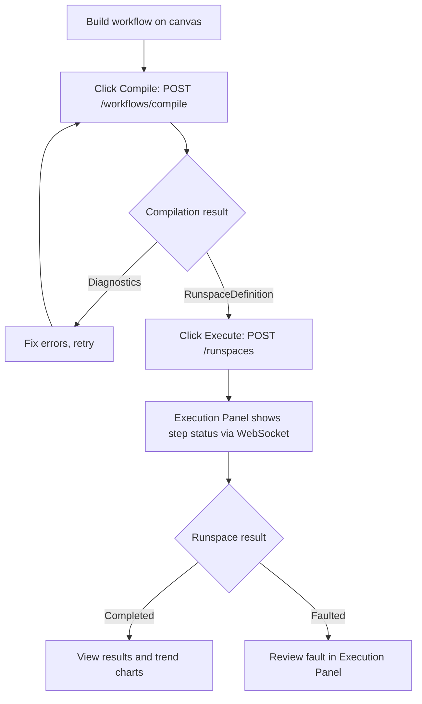

# Workflow Authoring Guide

## What is WSL?

WSL (Workflow Specification Language) is Helix's JSON graph format for describing automated experiments. A workflow is a directed graph where each node represents an operation and edges define execution order. The Rete.js canvas in the Tauri desktop app generates WSL JSON visually — you connect nodes on the canvas and the app serialises the graph to WSL automatically.

## Node Types

The Helix workflow engine supports seven node types:

| Node Type | Purpose | Example Use |
|-----------|---------|-------------|
| Step | Executes a single device capability (e.g. SetTemperature, RunMethod) | Set reactor A to 80°C |
| Condition | Evaluates a boolean expression on a workflow variable; routes flow to true or false edge | Check if pressure > 5 bar |
| Branch | Routes execution to one of multiple named branches based on a condition result | Select heating vs cooling protocol |
| Loop | Repeats a subgraph a fixed number of times | Run three wash cycles |
| Parallel | Executes multiple branches concurrently | Start pump and heater simultaneously |
| Delay | Waits a fixed duration before proceeding | Hold temperature for 10 minutes |
| WaitFor | Blocks until a trend value meets a condition (e.g. temperature reaches setpoint) | Wait until temperature >= 75°C |

## Building a Workflow in the Desktop App

The workflow builder is accessible from the Helix desktop app. You need an active Agent connection before authoring.

1. Open the Helix desktop app and connect to your Agent (enter the host and port on the connection screen, then click Connect).
2. Navigate to the **Workflow Builder** tab. The canvas shows available node types in the left palette.
3. Drag a **Step** node onto the canvas. In the properties panel, select a Device (e.g. vapourtec) and a Capability (e.g. SetTemperature). Fill in the parameters — for SetTemperature these are reactor index and target temperature in Celsius.
4. Drag a **Delay** node and connect it after the Step by drawing an edge from the Step output port to the Delay input port.
5. Add a **WaitFor** node after the Delay. Configure the trend condition expression (e.g. `vapourtec.temperature.A >= 75`).
6. Continue adding nodes until the workflow is complete. Use Parallel nodes to run device operations concurrently; use Loop nodes to repeat a subgraph a fixed number of times.
7. Click **Compile** — the app sends the WSL JSON to `POST /workflows/compile`. The compiler returns a RunspaceDefinition or a list of diagnostics. Fix any errors reported in the panel before proceeding.
8. Once compilation succeeds, click **Execute** — the app calls `POST /runspaces`. The Execution Panel shows step-by-step status updates via the WebSocket stream.

## Compile → Execute Flow

## Saving and Loading Workflows

Workflows can be saved to a local JSON file via the Workflow Library. Use **File → Save Workflow** to write the current WSL JSON to the local filesystem via Tauri's file system plugin. Saved files are stored in the location you choose.

Load a saved workflow by choosing **File → Open Workflow**. The canvas is fully restored from the saved WSL JSON — all nodes, edges, and parameter values are reconstructed.

## Safety Interlocks

The safety engine evaluates interlock rules on every trend update. If a limit is violated (e.g. temperature exceeds the safety envelope), the runspace is emergency-stopped automatically. The **Safety Panel** in the desktop app shows each rule, its current value, and whether it is in triggered or safe state.

Operators should review safety interlock rules before starting any experiment. Rules are configured per-device in the Agent's appsettings.json under the `SafetyEngine` section.
